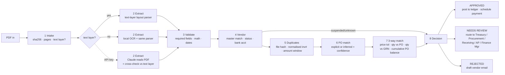

# AP Autopilot: Invoice PDF to reasoned decision

Built for the Zamp AI Solutions Analyst case study, problem statement PS-1 (Finance / AP).

The process takes a vendor invoice PDF, which can be a clean digital PDF or a skewed scan. It reads the invoice and checks it against a procurement system: the vendor master, purchase orders, goods receipts and the invoice ledger. It ends with one of three decisions: **Approved**, **Needs review** (sent to the team that owns the fix) or **Rejected** (sent back to the vendor). Every step is visible while it runs, and every decision states its reason.

```
React UI (Vite + Tailwind)  ──REST + Server-Sent Events──▶  FastAPI (Python)
  Dashboard · Live run view · Review queue                     8-stage pipeline (background thread)
  Procurement data · Rules & settings                          SQLite: runs · ledger · audit · settings
```

---

## Run it

**Option A, one command (Windows):** `./run.ps1`. On macOS, Linux or Git Bash: `./run.sh`.
Then open **http://localhost:8765**. The API and the built UI are served on that one port.

**Option B, dev mode (hot reload):**
```bash
# terminal 1
cd backend
python -m venv .venv && .venv/Scripts/pip install -r requirements.txt     # (bin/pip on mac/linux)
.venv/Scripts/python -m uvicorn app.main:app --port 8765 --reload
# terminal 2
cd frontend && npm install && npm run dev                                  # http://localhost:5190
```

**Troubleshooting: `WinError 10048` or `WinError 10013` on start.** Another process already holds port 8765, usually an earlier copy of this server. `run.ps1` detects this. If the earlier copy is this app, it just opens the browser; otherwise it prints the process ID to stop. To do it by hand, run `netstat -ano | findstr :8765`, then `Stop-Process -Id <pid>`.

**Option C, Docker:**
`docker build -t ap-autopilot . && docker run -p 8765:8765 ap-autopilot`
The image has been built and all 8 samples pass inside the container.

**Public link (Render, free tier):**
1. Push this `Zamp/` folder to its own GitHub repository.
2. On render.com, choose **New → Blueprint** and select the repository. It picks up `render.yaml` and builds the Dockerfile.
3. Optionally, set `ANTHROPIC_API_KEY` in the Render dashboard.

A free Render instance sleeps when idle, so the first request takes about 30 s. Open the link a minute before the interview.

**Tests:** `cd backend && .venv/Scripts/pip install pytest && .venv/Scripts/python -m pytest -q` runs 28 tests:
- all 8 demo decisions, plus the routing and the paid-now / on-hold amounts
- re-running an invoice, tolerance changes and the approval limit
- invoice formats it was **not** built around: unknown vendor, bundled invoice with no lines, tax-inclusive total, multi-page invoice, a PO that belongs to another vendor, a blank PDF
- the date, PO and OCR-split parsers

**Claude (optional).** Copy `backend/.env.example` to `backend/.env` and set `ANTHROPIC_API_KEY`. Without a key, everything still runs: text PDFs are parsed from the text layer, and scans are read by a local OCR engine (RapidOCR). Both paths produce the same output format.

**Regenerate the test invoices:** `backend/.venv/Scripts/python backend/scripts/generate_samples.py`

---

## Extraction stack (matches ai24c `Invoice_Processing`)

| Piece | ai24c | AP Autopilot | Needs |
|---|---|---|---|
| PDF rendering | PyMuPDF at 2× | PyMuPDF at 2× | nothing |
| LLM extraction | OpenAI `gpt-5-mini` vision + `instructor` → `GenericInvoice` | **Same.** Set `OPENAI_API_KEY` (and `OPENAI_BASE_URL=https://openrouter.ai/api/v1` for OpenRouter, as ai24c does) | your own key |
| Multi-invoice PDFs | Page classification with `gpt-5-mini`, then grouping | Same with an OpenAI key; otherwise local rules (invoice number per page, "Page 2 of 2") | — |
| OCR for scans | Google Cloud Vision `document_text_detection` | Google Vision when `GOOGLE_APPLICATION_CREDENTIALS` is set; otherwise **local RapidOCR** (free, offline) | optional GCP project |
| Field coordinates | Google Vision word boxes | PyMuPDF word boxes (text PDFs) or OCR boxes (scans), so it is free | nothing |
| Review screen | Resizable split: PDF left (pdf.js, zoom, pages), extracted data right, click a field to highlight it on the PDF | Same: `SplitPane` + `PdfViewer` + `ExtractedFields` | — |
| Edit and re-run | JSON form editor | **Correct fields**: the corrected values re-run the whole pipeline; the original run is kept and marked superseded | — |
| Export | JSON | JSON + CSV | — |

With no keys at all, everything still runs locally. Any LLM or Google failure (bad key, quota, network) falls back to the local reader automatically, and the run log says so.

## Operations features

| Feature | What it does | Where |
|---|---|---|
| **Email intake** | Upload an `.eml`, drop `.eml`/`.pdf` files into `backend/storage/inbox_drop/`, or poll a real mailbox over IMAP. Every PDF attachment becomes a run. The sender's domain is checked against the vendor master: a look-alike domain (e.g. `bluepeak-billing.example`) is treated as fraud. Re-sent emails (same Message-ID) are ignored. An email with no PDF gets a drafted reply. | **Inbox** page · `app/inbox.py` |
| **Learning from corrections** | When a reviewer corrects a field, the system turns it into a per-vendor rule: vendor-name aliases, and day-first date format (03/11/2026 = 3 Nov). The rule is applied automatically on that vendor's next invoice, logged every time it fires, and can be deleted. | Samples 11 → 12 · **Procurement data → Vendor master** · `app/memory.py` |
| **Notifications & SLAs** | Routed exceptions notify the owning team by Slack or email (shown in the in-app outbox when neither is configured). Each team has an SLA in hours; overdue items escalate once, to the team and the Finance Manager. Vendor emails are only ever drafts. | **Inbox → Outbox** · **Review queue** · `app/notify.py` |
| **Ask about this invoice** | Chat tab on each run. It uses the LLM when a key is configured, answering only from the run's own record; otherwise it gives rule-based answers drawn from the checks. | **Run → Ask** · `app/ask.py` |
| **Currency conversion** | Detects € £ ₹ C$ and ISO codes, European number formats (12.700,00) and dates (06.11.2026), IBAN and VAT IDs. Converts to USD using the rate table. The approval limit applies to the USD amount; a currency that doesn't match the vendor or PO goes to review. | Sample 10 · **Procurement data → FX & teams** |
| **AI rule generator** | Describe a policy in plain English, for example "Send invoices over $10,000 from Bluepeak to the Finance Manager". It becomes draft rules showing the readable condition, the outcome and the team, plus how many past invoices each would have caught. "A and B" becomes one rule with AND conditions; "A or B" becomes separate rules. Each draft can be added with one click or opened in the editor first. It uses the LLM (OpenAI or Claude) with a strict schema of allowed fields and operators when a key is configured, otherwise a built-in phrase parser, so it always works. | **Rules & settings → Custom rules** · `app/rules.py` |
| **Replace the PO spreadsheet** | The problem statement says AP "finds the matching PO in a spreadsheet". Here the AP team **imports its own spreadsheet** (CSV or Excel) of purchase orders, goods receipts or vendors. Columns are mapped automatically and can be adjusted, every row is validated, and a review step shows *n new · n updated · n errors* before anything is written, with merge or replace. A template is available to download. A sheet can also be **linked live** (Google Sheets, OneDrive or any CSV URL) and is re-read on a schedule. POs and goods receipts can be **edited in the app**, and every import and edit goes into a History log. | **Procurement data → Import / Sources / History** · `app/refdata.py` |
| **Manual check made easy** | When a person wants to check by hand, the run page's **PO match** tab shows the invoice lines next to the PO lines (ordered · received · billed before, price against PO price) with differences highlighted, so nobody opens Excel. **Change PO** picks a different PO, or chooses one when none was printed, and the whole decision re-runs with it, with the choice recorded in the audit trail. | **Run → PO match** |
| **Custom rules** | AP teams add their own checks without code. Each rule is `field op value` with an outcome of review or reject and a team to route to, for example "vendor name contains *northwind* → review by Procurement" or "total in USD > 10,000 → Finance Manager". Rules run in the Decision stage after the built-in checks and appear as normal checks. A dry run shows which past invoices a rule would have caught. | **Rules & settings** · `app/rules.py` |
| **Analytics** | Duplicates blocked, fraud signals held, value on hold, exception reasons, payment calendar, SLA health, per-vendor exception rate, currencies, and learning stats. | **Analytics** page |

**Demo of learning:** run sample 11 (Harbor, "03/11/2026"). It is read as 11 March, so it looks 8 months old and is held. Open *Extracted data → Correct fields* and set the date to 2026-11-03, then save and re-run. The re-run is approved and learns "Harbor writes dates day-first". Now run sample 12 ("07/11/2026"): it is read as 7 November automatically, and the log names the rule.

**Demo of escalation:** set *SLA · Treasury & Security* to `0.01` hours on the Rules page, receive the Bluepeak sample email, and wait about 30 s (or click *Check SLAs*). Escalations appear in the Outbox.

## Process map



### Decision policy

Each check produces `pass / warn / fail / info`, and may carry one of two outcomes:

| Outcome | Used when | Examples |
|---|---|---|
| **reject** | The invoice must never be paid as submitted | Duplicate of an already paid or approved invoice; suspended vendor; missing invoice number or date |
| **review** | A person can resolve it, so it goes to the team that owns the fix | Bank account differs from the master (**Treasury & Security**); PO overrun or charge not on the PO (**Procurement**); billed but not received (**Receiving**); low extraction confidence or totals that don't add up (**AP Specialist**) |
| *(none)* | Informational, or inside tolerance | Unit price 1.2% above the PO with a 2% tolerance |

Any reject means **Rejected**. Otherwise, any review means **Needs review**, routed to the highest-priority team (Treasury > Procurement > Receiving > AP). Otherwise, an invoice above the auto-approval limit goes to the **Finance Manager**. Otherwise it is **Approved**: it is posted to the ledger, and payment is scheduled to the bank account **from the vendor master, never the one printed on the invoice**.

When only part of an invoice is in question, the decision also works out the **amount that can be paid now** and the **amount on hold**. For example, it pays the delivered units and holds the undelivered ones.

All tolerances can be changed from the UI on the Rules page (unit-price %, absolute slack, PO overrun %, approval limit, duplicate window, minimum extraction / PO-inference confidence).

---

## Test inputs and edge cases

There are 8 prepared invoices in `backend/samples/`. Each vendor uses its own layout and labels: *Invoice No / Invoice # / Invoice Number*, *PO Number / Purchase Order / Your Ref / Customer PO*, and dates written as ISO, US, `06 Nov 2026` or `Nov 5, 2026`.

| # | Scenario | Expected result | What it shows |
|---|---|---|---|
| 1 | **Happy path:** Northwind, clean PDF, explicit PO | Approved | Full 3-way match; posted to the ledger; payment scheduled |
| 2 | **Scanned image:** Harbor Print, no text layer, skewed and noisy | Approved | OCR path with deskew; the OCR glued "2000 1.15" into "20001.15", and the parser recovers it by finding the split where qty × price = amount |
| 3 | **Edge: split billing overruns the PO.** Meridian's 3rd invoice on a 3-shipment PO | Needs review, Procurement | Reads prior invoices from the ledger, finds the cumulative overrun ($14,450 vs $12,600) and the unplanned $1,850 detention charge, then **recommends paying the $4,200 the PO covers and holding $1,850** |
| 4 | **Edge: no PO reference and a partial receipt.** Crestline | Needs review, Receiving | **Infers the PO** by scoring the vendor's open POs (line coverage, SKU and description similarity, fit with the remaining balance) against a decoy PO. Accepts a +1.21% price drift within tolerance. Catches **8 gauges billed but only 12 of 20 received**, so pays the received portion |
| 5 | **Edge: disguised duplicate.** Northwind "payment reminder" | Rejected | `NW10482` vs ledger `INV-NW-10482`: normalised invoice-number core + same amount + same date. Drafts a reply to the vendor |
| 6 | **Edge: bank details changed (BEC fraud pattern).** Bluepeak | Needs review, Treasury & Security | Everything else matches perfectly, which is why this fraud works. The remit-to account differs from the vendor master, and the text announces a bank change and pushes for urgent payment. Does **not** draft a reply to the sender; tells AP to call back on the phone number in the master file |
| 7 | Suspended vendor: Orion | Rejected | Valid PO and amounts, but the vendor is blocked by Procurement |
| 8 | Missing invoice number and date ("statement of charges") | Rejected | Asks the vendor for a compliant invoice |

**Live behaviours to show in a demo:**
- Run sample 1 **twice**. The second run is rejected as a duplicate, because the first run posted to the ledger.
- Approve sample 3 from the review queue. The ledger and the PO's remaining balance update immediately (Procurement data page).
- Lower the unit-price tolerance to 1% on the Rules page and re-run sample 4. The price drift becomes a Procurement issue.

---

## Design decisions (and why)

1. **"The model reads, the rules decide."** OCR or an LLM is good at *reading* messy documents. It should not be the thing that *decides* whether to pay $19,440. The decisions come from deterministic rules with configurable tolerances. So the same invoice always gets the same answer, every reason can be traced to a rule, and an auditor can follow it.
2. **Extraction confidence is tracked per field**, and low confidence is a reason for review in its own right. With Claude enabled, the model's output is **cross-checked against the PDF text layer**. If the two disagree on totals, invoice number or PO, a person looks at it, so a wrong value from the model cannot silently change a payment.
3. **Works without an API key.** The demo can't fail because of a network or quota problem. A layout-aware parser rebuilds visual rows from word coordinates, and a local OCR engine reads the scans.
4. **Matching is stateful.** Split invoices and duplicates only make sense against history. The process reads the invoice ledger, and approved invoices write back to it.
5. **Routing over rejecting.** Most exceptions are fixable. Sending them to the right team, with the reason, a recommended partial payment and a drafted vendor email, is what saves AP time.
6. **Fraud signals are treated differently.** A bank-account mismatch never produces an email to the address on the invoice, and payment always goes to the account in the master file.
7. **One invoice at a time.** Runs are processed one after another, so two invoices can't both pass the PO-balance check against the same remaining amount.

## Assumptions (made for the exercise)

- The currency is USD. Invoices without a currency symbol take the vendor-master currency.
- Tax: sales tax is checked against the PO's tax code. Tax-inclusive totals are detected and only reported.
- The PO and ledger "spreadsheets" are a JSON reference file plus a SQLite ledger, standing in for the ERP.
- Quantity tolerance on goods receipt is 0 (you can't pay for undelivered units). Price tolerance is ±2%.
- Invoices dated in the future, or more than 180 days old, go to a person for review.
- "Today" can be pinned with `AP_TODAY` so the demo data never goes stale.

## Limitations / next steps

- Email intake (IMAP or Gmail watch) to replace the upload step. Multi-invoice PDFs (split by page classification).
- Credit notes and negative invoices; currency conversion; withholding tax.
- Vendor-specific extraction templates learned from reviewer corrections.
- Role-based access for reviewer actions; SSO.
- ERP connectors (NetSuite / SAP) in place of the JSON and SQLite reference data.

## Code map

```
backend/app/
  extraction.py   text-layer row rebuild, OCR (RapidOCR + deskew), label/layout parser, Claude extraction + cross-check
  pipeline.py     the 8 stages, checks, decision policy, narrative + vendor emails
  db.py           SQLite: runs, ledger, audit, settings
  main.py         FastAPI: runs, SSE stream, review, reference data, stats, settings
backend/data/reference.json    vendor master, POs, goods receipts, seeded ledger
backend/samples/               8 generated test invoices + catalog.json
frontend/src/pages/            Dashboard, NewRun, RunView (live), ReviewQueue, Reference, Settings
```
